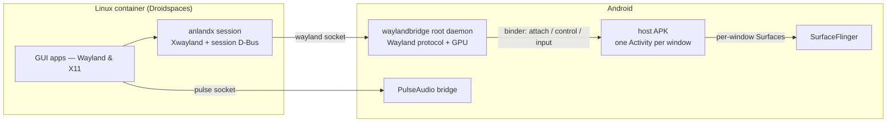

# Anland — a Wayland host for Android

**English** | [简体中文](README_CN.md)

Anland runs the graphical Linux apps of a container on a **rooted Android** device and shows each of them as a **native Android window** — its own entry in the app switcher, its own Surface, its own soft-keyboard focus. There is no virtual screen and no mirroring: every app gets a real window, and Android's own compositor keeps drawing the screen.

It ships as a SukiSU/KernelSU module (`anland-awl`): a root daemon, a host APK, the session inside the container, and an audio bridge. The companion launcher [anland-shell](https://github.com/misaka5202/anland-shell) manages the containers and starts the apps.

> [!IMPORTANT]
> **Branch status.** `main` is the active development branch — the refactored 6.x
> architecture. As a consequence of the rewrite it does not yet reach the feature
> completeness of 5.x: if you want stability and the full desktop experience, use
> the [`legacy`](https://github.com/misaka5202/anland/tree/legacy) branch
> (5.x) instead. 5.x stays in maintenance until 6.x catches up with the 5.x
> feature set (complete desktop, virtual keyboard, accessibility, …).
> Maintenance is bug fixes only — and only functional bugs that affect usage;
> intermittent glitches that a restart of the consumer app clears are out of
> scope.

**Why the rewrite?** 5.x exchanged frames over a private display protocol (the
"Anland Display Protocol"): every compositor — KWin, Weston, … — needed its own
adaptation backend written against that protocol, and each of those had to be
maintained separately. The 6.x refactor makes Wayland itself the frame-exchange
protocol, so stock compositors work unmodified and only the host side needs
maintaining.

## Why it is not a standard compositor

A standard Wayland compositor — Weston, Sway, a desktop session — takes over a machine's display: it owns the whole screen, composites every client into one output, reads input from evdev, and clients reach it through the `wayland-0` socket. On a phone that model degrades into "one fullscreen remote-desktop window". Anland keeps the protocol half of a compositor and replaces the display half with Android itself:

| | Standard compositor | Anland |
|---|---|---|
| Screen | Owns the display, composites everything into one output | Owns no display — Android's SurfaceFlinger keeps compositing |
| Windows | Internal window management inside a single output | Every `xdg_toplevel` becomes one real Android window (its own Activity and Surface) |
| Connection | A `wayland-0` unix socket file | No socket file — connections are fds passed over Android binder |
| Client identity | All clients are the same session user | Every client connects with its own uid; windows are owned per app |
| Input | evdev/libinput from DRM devices | Each window's Android touch/key/IME events, translated to Wayland |
| Lifecycle | A user session process | A root daemon in its own SELinux domain — not an app uid, so OEM "battery optimization" cannot freeze it |

What that design buys you:

- **Linux windows are first-class Android windows.** They appear in the app switcher, split-screen and behave like ordinary app windows — each with its own focus and its own IME state, candidates following the cursor.
- **Hidden windows park their clients.** With no Android surface attached, the daemon stops draining that window's buffers, so a minimized Linux app neither spins nor burns GPU frames.
- **Foreground apps are scheduled like foreground apps.** While a window is attached, its client's whole process tree is moved into Android's top-app cgroups — the Linux app in front of you is scheduled like any foreground Android app, not like a background daemon.
- **Sound included.** A PulseAudio bridge plays the container's audio through Android's own audio stack.
- **X11 apps included.** The in-container session runs a patched rootless Xwayland, so X11 apps show up as windows the same way Wayland apps do.
- **Real-device fixes the stock stack lacks.** A bubblewrap that survives KernelSU+SuSFS fake mount ids, and an Xwayland that does accelerated GL on Adreno GPUs (kgsl/turnip) — see `patches/`.
- **Any Android app can join in.** The `libawl` client library lets a third-party app connect over binder and host its own Wayland windows, scoped to that app's uid.

## How it fits together



The pieces:

- **`waylandbridge`** — the daemon: a single statically-linked ELF holding both the Wayland protocol side and the GPU renderer. It renders each window's frames directly into the Surface of that window's Android Activity.
- **Host APK (`com.anlandnext`)** — spawns one Activity per window, feeds it input, and provides the window list and settings UI.
- **`libawl`** — the client library (AAR) that third-party apps embed to host their own windows.
- **anlandx** — the session inside the container: links the daemon's socket, runs rootless Xwayland with a small X window manager, and publishes the app environment.
- **pulse** — PulseAudio for Android (OpenSL ES / AAudio sinks) so container apps have sound.
- **module** — the SukiSU/KernelSU packaging: boot service, SELinux domain, contexts generated at flash time from the device's live system files.

## Rendering backends: SC and EGL

The daemon composites each window through one of two backends, selected by
`sc_enabled` in the daemon config (`/data/adb/modules/anland-awl/config.json`,
default `1`; applied when a window attaches):

- **SC (SurfaceControl) — efficient, low overhead, scanout direct.** Every
  wayland layer becomes a SurfaceControl sibling and SurfaceFlinger/HWC does the
  compositing — the daemon composites nothing, and a client's dma-buf can be
  scanned out zero-copy on an HWC plane. The trade-off: surface *movement*
  responds more slowly, since positions land through SF transactions. Best for
  content whose surfaces mostly sit still — games.
- **EGL (GL renderer) — smooth movement, higher GPU usage.** A per-window GPU
  compositor samples every layer into one buffer and presents it through
  eglSwapBuffers. Surface movement is smooth, at the price of a GPU composite
  every frame. Best for scrolling content — web browsing.

## Requirements

- **Android 14 (API 34) or newer.** The daemon calls
  `ANativeWindow_readFromParcel`, an API 34 symbol, with no fallback. On
  Android 13 it fails to load:
  `CANNOT LINK EXECUTABLE ... cannot locate symbol "ANativeWindow_readFromParcel"`.
  See [doc/ANDROID-VERSION-REQUIREMENTS.en.md](doc/ANDROID-VERSION-REQUIREMENTS.en.md).
- A rooted arm64 device (SukiSU or KernelSU)
- A Droidspaces Linux container
- The host APK installed — windows attach through it, and audio requires it

> The `droidspaces-lkm` KMI matrix lists Android 12/13 support, but that is the
> **kernel module** side. anland6's user-space `waylandbridge` is a separate
> matter and needs Android 14+.

## Install

1. Get the three artifacts — `anland-awl.zip` (module), `anland-wayland.apk` (host), `anlandx.tar.gz` (container session). Take them from the latest release
   ([v6.2.8](https://github.com/misaka5202/anland/releases/tag/v6.2.8), this fork — not upstream, see below), or build them (below).
2. Flash the zip in your root manager and reboot. The daemon starts at boot (log: `/data/local/tmp/awl_daemon.log`).
3. Install `anland-wayland.apk`.
4. Inside the container, set up the session:

   ```sh
   tar xzf anlandx.tar.gz && bash anlandx/setupanlandx.sh
   ```

5. Manage containers and launch apps with [anland-shell](https://github.com/misaka5202/anland-shell).

Full release history: [doc/CHANGELOG.md](doc/CHANGELOG.md).

## Why this fork instead of upstream 6.2

Upstream 6.2 cannot type. This fork fixes the whole input chain; releases are
tagged `v6.2.N` and built from `main`.

1. **Soft-keyboard text never reaches apps.** Apps without `zwp_text_input_v3`
   (terminals such as Konsole/XTerm) got nothing — `awl_ime_text()` dropped the
   commit. The fork degrades ASCII text to `wl_keyboard` key events, the path
   the Enter key already uses.
2. **Chinese input is impossible upstream.** No `zwp_input_method_v2`, so a
   container IME (fcitx5) had nowhere to deliver text. The fork implements it.
3. **Windows never appear.** The xdg configure carried serial `0`, which clients
   discard, so the surface never maps and anland-shell does nothing on tap.
   The fork uses `next_serial`.
4. **X11 apps could not read the clipboard.** The selection only advertised
   `text/plain*`; Konsole and other Xwayland clients ask for `UTF8_STRING`.
   The fork advertises `UTF8_STRING` / `TEXT` / `STRING`.
5. **Reinstalling the module wiped `config.json`.** `runtime_dir` fell back to
   the compiled default and stopped matching the container's `bind_mounts`, so
   the socket was invisible inside the container. `customize.sh` now
   regenerates it from the container's bind source.
6. **The extra-keys bar was partly dead.** Its leftmost column (ESC/TAB) sat in
   the system back-gesture region. The fork insets the bar by
   `WindowInsets.Type.systemGestures()`.

For terminals (no `text_input`), Chinese goes through the Wayland selection
plus the terminal's paste shortcut — configurable as `paste_shortcut` in
`config.json` (default `ctrl+shift+v`).

## What changed in v6.2.7 and v6.2.8

- **A window could stay half on the previous frame.** `wl_surface.damage`
  carries surface coordinates while `wl_surface.damage_buffer` carries buffer
  coordinates; the daemon used the surface-space rectangle as buffer pixels, so
  a scale-aware client (a browser at zoom > 100%) had its damage uploaded at the
  wrong offset and at a fraction of the size — a misplaced block over the
  canvas. The rectangle is now scaled into the buffer grid (kwin's
  `mapToBuffer`). The compositor keeps its own canvas (kwin's `BufferImage`),
  so the pixels outside the damage rect stay correct across the client's buffer
  swap and only the damaged region is uploaded: 15x less traffic than the full
  re-upload this replaces.
- **Every frame re-sent an unchanged layer geometry.** The position, scale,
  transform and transparency are now applied only when they actually change
  instead of on every buffer latch.
- **anland-shell taps did nothing.** `auto_attach` now defaults to on, so the
  daemon starts the host activity as soon as a wayland window is created
  instead of waiting for a binder SURFACE.
- **Stale PulseAudio instances.** `service.sh` also kills the old server by
  process name, so moving `runtime_dir` can no longer leave two servers holding
  two Android tracks.
- **Native PipeWire apps were silent.** `anlandx` installs a PipeWire tunnel
  sink to the host PulseAudio, plus a watchdog that rebuilds it after a host
  daemon restart.

## Build

Linux host with JDK 17, an Android SDK (`ANDROID_HOME` and `JAVA_HOME` set; missing pieces are auto-installed), plus meson/ninja/patch for the audio part.

```sh
git submodule update --init --recursive
make        # waylandbridge + host APK + module zip + anlandx tarball
```

CI builds every push/PR and uploads the artifacts.

## Related projects

- [anland-shell](https://github.com/misaka5202/anland-shell) — the launcher: container management and the app grid that drives all of this.

## License

GPL-3.0. Bundled third-party components (libwayland, PulseAudio, bubblewrap, Xwayland, …) keep their own licenses.
