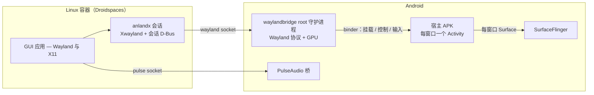

# Anland — Android 上的 Wayland 宿主

**简体中文** | [English](README.md)

Anland 在 **已 root 的 Android** 设备上运行 Linux 容器里的图形应用，并把每一个应用显示为一个**原生 Android 窗口**——在最近任务里有自己的卡片、有自己的 Surface、有自己的输入法焦点。没有虚拟屏幕，也没有画面镜像：每个应用拿到一个真正的窗口，屏幕仍由 Android 自己的合成器绘制。

它以 SukiSU/KernelSU 模块（`anland-awl`）的形式发布：一个 root 守护进程、一个宿主 APK、容器内的会话，以及音频桥。配套启动器 [anland-shell](https://github.com/misaka5202/anland-shell) 负责管理容器和启动应用。

> [!IMPORTANT]
> **分支状态。** `main` 是活跃开发分支（重构后的 6.x 架构）。由于重构，功能尚不及
> 5.x 完整：追求稳定和完整桌面体验请使用
> [`legacy`](https://github.com/misaka5202/anland/tree/legacy) 分支（5.x）。
> 5.x 会持续维护，直到 6.x 补齐 5.x 的功能（完整桌面、虚拟键盘、无障碍等）。
> 维护仅限 bug 修复——且只接受影响使用的功能性 bug；重启 consumer app 即可解决的
> 概率性小问题不在维护范围内。

**为什么重构？** 5.x 用一套私有显示协议（"Anland Display Protocol"）交换帧：每个合成器
——KWin、Weston……——都要针对该协议单独维护一套适配后端，维护成本高。6.x 的重构把帧
交换协议标准化为 Wayland 本身，原生合成器无需改动即可接入，只有宿主一侧需要维护。

## 它和标准合成器有什么不同

标准的 Wayland 合成器——Weston、Sway、桌面会话——接管整台机器的显示：独占整个屏幕、把所有客户端合成到一个输出、从 evdev 读取输入，客户端通过 `wayland-0` socket 连接。这套模型放到手机上就会退化成"一个全屏的远程桌面窗口"。Anland 保留了合成器的协议那一半，把显示那一半交还给 Android：

| | 标准合成器 | Anland |
|---|---|---|
| 屏幕 | 独占显示，把一切合成到单一输出 | 不持有任何显示——SurfaceFlinger 继续负责合成 |
| 窗口 | 在单一输出内部做窗口管理 | 每个 `xdg_toplevel` 变成一个真正的 Android 窗口（独立的 Activity 和 Surface） |
| 连接 | `wayland-0` unix socket 文件 | 没有 socket 文件——连接通过 Android binder 传递 fd |
| 客户端身份 | 所有客户端都是同一个会话用户 | 每个客户端以自己的 uid 连接；窗口按应用归属 |
| 输入 | 来自 DRM 设备的 evdev/libinput | 每个窗口的 Android 触摸/按键/输入法事件，翻译成 Wayland 事件 |
| 生命周期 | 一个用户会话进程 | 自有 SELinux 域的 root 守护进程——不是 app uid，厂商"省电优化"冻结不了它 |

这套设计带来的东西：

- **Linux 窗口是一等公民的 Android 窗口。** 出现在最近任务里、支持分屏、表现和普通应用窗口一致——各自持有焦点和输入法状态，候选框跟随光标。
- **隐藏的窗口会让客户端挂起。** 没有 Android surface 挂载时，守护进程停止消费该窗口的缓冲区，最小化的 Linux 应用既不空转也不烧 GPU 帧。
- **前台应用按前台调度。** 窗口挂载期间，客户端的整个进程树会被移入 Android 的 top-app cgroup——眼前的 Linux 应用按前台 Android 应用调度，而不是像后台守护进程那样被限速。
- **自带声音。** PulseAudio 桥把容器的音频经由 Android 自己的音频栈播放出来。
- **自带 X11。** 容器内会话运行打过补丁的 rootless Xwayland，X11 应用和 Wayland 应用一样以窗口形式出现。
- **真机问题真修复。** 能在 KernelSU+SuSFS 伪挂载 id 下存活的 bubblewrap，以及在 Adreno GPU（kgsl/turnip）上做硬件加速 GL 的 Xwayland——见 `patches/`。
- **任何 Android 应用都能加入。** 第三方应用通过 `libawl` 客户端库经 binder 连接，托管自己的 Wayland 窗口，权限按该应用的 uid 隔离。

## 组合起来是什么样



各组成部分：

- **`waylandbridge`**——守护进程：单个静态链接的 ELF，同时容纳 Wayland 协议侧和 GPU 渲染器。它把每个窗口的帧直接渲染进该窗口 Android Activity 的 Surface。
- **宿主 APK（`com.anlandnext`）**——每个窗口启动一个 Activity、喂入输入事件，并提供窗口列表和设置界面。
- **`libawl`**——客户端库（AAR），第三方应用嵌入后即可托管自己的窗口。
- **anlandx**——容器内的会话：链接守护进程的 socket、运行 rootless Xwayland 和一个小型 X 窗口管理器、发布应用环境。
- **pulse**——Android 版 PulseAudio（OpenSL ES / AAudio 输出），让容器应用有声音。
- **module**——SukiSU/KernelSU 模块封装：开机服务、SELinux 域、刷入时从设备活系统文件生成 contexts。

## 渲染后端：SC 与 EGL

守护进程以两种后端之一合成每个窗口，由守护进程配置（`/data/adb/modules/anland-awl/config.json` 的
`sc_enabled`，默认 `1`，窗口挂载时生效）决定：

- **SC（SurfaceControl）——高效、低占用、扫描直出。** 每个 wayland 图层成为一个
  SurfaceControl 兄弟层，由 SurfaceFlinger/HWC 负责合成——守护进程自己不合成，客户端的
  dma-buf 可以零拷贝直上 HWC 平面。代价是 surface *移动* 响应较慢：位置要经由 SF 事务
  落地。适合 surface 基本不动的场景——游戏。
- **EGL（GL 渲染器）——移动平滑、GPU 占用高。** 每窗口一个 GPU 合成器，把所有图层
  采样进一个缓冲区，经 eglSwapBuffers 呈现。surface 移动平滑，代价是每帧一次 GPU
  合成。适合滚动内容——网页浏览。

## 环境要求

- **Android 14（API 34）或更高。** 守护进程调用 `ANativeWindow_readFromParcel`
  —— 这是 API 34 才引入的符号，代码里没有低版本回退。Android 13 上会加载失败：
  `CANNOT LINK EXECUTABLE ... cannot locate symbol "ANativeWindow_readFromParcel"`。
  详见 [doc/ANDROID-VERSION-REQUIREMENTS.zh-CN.md](doc/ANDROID-VERSION-REQUIREMENTS.zh-CN.md)。
- 已 root 的 arm64 设备（SukiSU 或 KernelSU）
- 一个 Droidspaces Linux 容器
- 已安装宿主 APK——窗口经由它挂载，音频也依赖它

> `droidspaces-lkm` 的 KMI 覆盖矩阵写着支持 Android 12/13，但那是**内核模块**
> 那一侧。anland6 用户态的 `waylandbridge` 是另一回事，需要 Android 14+。

## 安装

1. 取得三个产物：`anland-awl.zip`（模块）、`anland-wayland.apk`（宿主）、`anlandx.tar.gz`（容器会话）——从最新 Release
   [6.2-ds7](https://github.com/misaka5202/anland/releases/tag/6.2-ds7)（**本 fork**，不是上游，原因见下）取，或自己构建（见下）。
2. 在 root 管理器里刷入 zip 并重启。守护进程开机自启（日志：`/data/local/tmp/awl_daemon.log`）。
3. 安装 `anland-wayland.apk`。
4. 在容器内搭建会话：

   ```sh
   tar xzf anlandx.tar.gz && bash anlandx/setupanlandx.sh
   ```

5. 用 [anland-shell](https://github.com/misaka5202/anland-shell) 管理容器、启动应用。

## 为什么用本 fork 而不是上游 6.2

上游 6.2 **打字是不可能的**。本 fork 修了整条输入链，Release 以 `6.2-dsN` 标记、由 `main` 构建。

1. **软键盘文本到不了应用。** 不实现 `zwp_text_input_v3` 的应用（Konsole/XTerm
   这类终端）什么都收不到 —— `awl_ime_text()` 直接丢弃 commit。改版把 ASCII
   文本降级成 `wl_keyboard` 按键（回车键走的就是这条，已实测可用）。
2. **上游中文输入不可能。** 没有 `zwp_input_method_v2`，容器内的 fcitx5 拿着字
   无处可送。改版实现了它。
3. **应用窗口起不来。** xdg configure 的 serial 为 0，客户端丢弃后 surface 永不
   map，anland-shell 点应用没反应。改版改用 `next_serial`。
4. **X11 应用读不到剪贴板。** 选区只声明 `text/plain*`，Konsole 这类 Xwayland
   客户端要的是 `UTF8_STRING`。改版补上 `UTF8_STRING` / `TEXT` / `STRING`。
5. **重装模块会丢 `config.json`。** `runtime_dir` 退回编译默认值，和容器的
   `bind_mounts` 对不上，socket 在容器里看不见。`customize.sh` 现在会按容器
   bind 源目录重新生成。
6. **额外按键栏有一部分是死的。** 最左列（ESC/TAB）落在系统返回手势区，touch
   被手势吃掉。改版用 `WindowInsets.Type.systemGestures()` 给底栏让边。

终端（无 `text_input`）的中文走 Wayland 选区 + 该终端的粘贴键，可在
`config.json` 用 `paste_shortcut` 配置（默认 `ctrl+shift+v`）。

## 6.2-ds6 之后的变化

- **窗口可能一半卡在上一个画面。** 新附着的 `wl_shm` buffer 不是「旧 buffer 改
  了几个矩形」，所以 SC 后端改为在 attach 时整张纹理重传，而不是只传 damage
  矩形。这也解释了「打完字要等输入框收起才上屏」。
- **anland-shell 点应用没反应。** `auto_attach` 现在默认打开，daemon 在 wayland
  窗口创建时就直接拉起宿主 Activity，不再等 binder SURFACE。
- **残留的 PulseAudio 实例。** `service.sh` 现在也按进程名杀掉旧服务器，
  `runtime_dir` 变动不会再留下两个服务器各占一条 Android 音频轨。
- **原生 PipeWire 应用没声音。** `anlandx` 会装一个到主机 PulseAudio 的 PipeWire
  隧道 sink，并带一个 watchdog：主机 daemon 重启后自动重建。

## 构建

需要 Linux 主机、JDK 17、Android SDK（设置 `ANDROID_HOME` 与 `JAVA_HOME`；缺失组件自动安装），音频部分另需 meson/ninja/patch。

```sh
git submodule update --init --recursive
make        # waylandbridge + 宿主 APK + 模块 zip + anlandx 压缩包
```

CI 会在每次 push/PR 时构建并上传产物。

## 相关项目

- [anland-shell](https://github.com/misaka5202/anland-shell)——启动器：容器管理与启动这一切的应用格子。

## 许可证

GPL-3.0。随附的第三方组件（libwayland、PulseAudio、bubblewrap、Xwayland 等）保留各自许可证。
